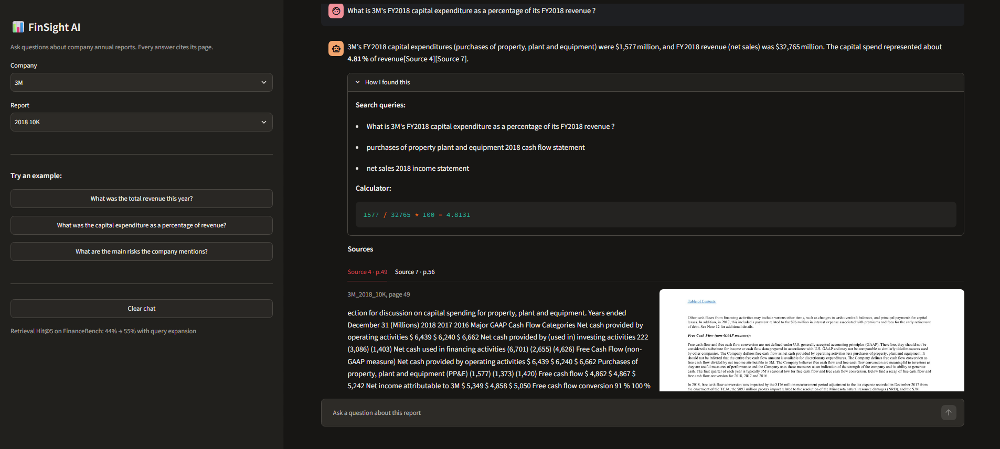

# FinSight AI

**A RAG assistant that answers questions about company annual reports, with page citations and a calculator tool.**

🔗 **Live demo:** [finsight-ai.streamlit.app](https://finsight-ai-ndhcqwtu5gbdoqvzdav5gb.streamlit.app/) (12 reports from FinanceBench)


---

## Overview

Annual reports (10-K filings) are long, often more than 100 pages. FinSight AI lets you pick a report and ask questions about it in a chat. For every answer it:

- uses only information from the report
- cites the page it came from, and shows that page
- uses a calculator tool for any maths, so numbers are not made up by the LLM
- says *"I could not find this in the report"* if the answer is not there

## Results

I evaluated the search on the 150 questions in [FinanceBench](https://github.com/patronus-ai/financebench), a benchmark of real analyst questions about company reports. Each question includes the page where the answer is, so I measured **Hit@5**: how often at least one of the top 5 search results comes from the correct page.

| Search method | Hit@5 |
|---|---|
| BM25 (keywords) | 28.7% |
| Embeddings (semantic) | 50.0% |
| Hybrid (BM25 + embeddings) | 44.0% |
| **Hybrid + query expansion** | **55.3%** |

## How it works

```
Question
   │
   ├─ 1. LLM splits it into smaller search queries (one per fact needed)
   │
   ├─ 2. Hybrid search for each query
   │      ├─ BM25 keyword search (with finance synonyms added)
   │      ├─ Embedding search (all-MiniLM-L6-v2)
   │      └─ Combined with Reciprocal Rank Fusion
   │
   ├─ 3. LLM answers using only the retrieved chunks
   │      └─ calls the calculator tool for any maths
   │
   └─ Answer with [Source] citations + the PDF pages
```

**Chunking:** each PDF is split page by page into 800-character chunks with 150 characters of overlap. A chunk never crosses two pages, so every chunk has exactly one page number for citations.

**Query expansion:** questions and reports often use different words. For example, a question asks about "capex", but the report says "purchases of property, plant and equipment". I added a small finance synonym list, and I also change "FY2018" to "2018".

**LLM:** `openai/gpt-oss-120b` on Groq (free tier), using the OpenAI Python client.

## Example

**Question:** *What is 3M's FY2018 capital expenditure as a percentage of its FY2018 revenue?*

1. Search queries: `purchases of property plant and equipment 2018 cash flow statement`, `net sales 2018 income statement`
2. Found capex **$1,577M** (page 49) and net sales **$32,765M** (page 56)
3. Calculator: `1577 / 32765 * 100 = 4.81`
4. **Answer: about 4.81% of revenue**, citing both pages



## What I learned

- **Hybrid search was worse than embeddings alone at first.** BM25 was missing answers whenever the question and the report used different words, and it pulled the combined ranking down. Query expansion fixed this and made hybrid the best method.
- **Many problems were search problems, not LLM problems.** The 3M question above first returned "not found". The LLM was fine; the search could not find two numbers on two different pages with one query. Splitting the question into smaller queries fixed it, but only after I told the LLM to use the report's own words ("net sales" instead of "revenue").
- **Small bugs can break evaluation silently.** FinanceBench page numbers start at 0 and mine start at 1. Without fixing this, every score would have been wrong without any error.

## Project files

| File | What it does |
|---|---|
| `download_data.py` | Downloads the FinanceBench questions and the 84 PDFs |
| `chunker.py` | Splits the PDFs into page-level chunks |
| `query_expansion.py` | Finance synonyms and FY year handling |
| `search.py` | Hybrid search (BM25 + embeddings + RRF) |
| `evaluate.py` | Calculates Hit@5 on FinanceBench |
| `answer.py` | Query splitting, LLM answer, citations, calculator tool |
| `app.py` | Streamlit web app |
| `api.py` | FastAPI endpoint (`POST /ask`) |
| `config.py` | Settings (paths, chunk size, model names) |

## How to run

**Requirements:** Python 3.11 or 3.12, and a free API key from [Groq](https://console.groq.com).

**1. Install**
```
py -3.12 -m venv .venv
.venv\Scripts\Activate.ps1
pip install -r requirements.txt
```

**2. Add your API key:** copy `.env.example` to `.env` and paste your key.

**3. Prepare the data**
```
python download_data.py
python chunker.py
python evaluate.py
```
The first run of `evaluate.py` creates the embeddings for all chunks (around 5-15 minutes on a laptop CPU).

**4. Run the app**
```
streamlit run app.py
```
Or run the API with `uvicorn api:app --reload` and open http://127.0.0.1:8000/docs

## Limitations

- I wrote the synonym list after looking at the FinanceBench questions, so the improvement may be a bit optimistic. A fairer test would use questions I have not seen.
- I only evaluated the search, not the final answers.
- Tables lose their layout when the PDF is converted to text, so some numbers are hard to find.
- 150 questions is a small test set, so a few questions can change the score by a few percent.

## Future improvements

- Evaluate the final answers against the FinanceBench answers
- Add a re-ranker model after the hybrid search
- Better handling of tables in the PDFs

## Tech stack

Python · PyMuPDF · rank-bm25 · sentence-transformers · Groq · FastAPI · Streamlit

Data: [FinanceBench](https://github.com/patronus-ai/financebench) by Patronus AI
